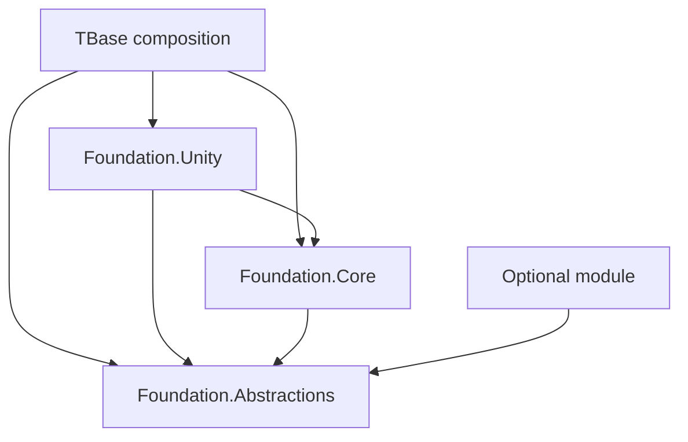

# TBase Unity Foundation Architecture

Status: Phase 1.6 sample, scene-host reload and Windows Mono validation completed 2026-10-10; release/distribution gates remain open.
Inspection date: 2026-10-09. Companion documents: [requirements](REQUIREMENTS.md), [roadmap](ROADMAP.md), [agent rules](AGENTS.md).

## Repository and environment findings

The user clarified that TBase is the main project and no separate unity-foundation-test repository is needed. The framework must still be independent of this project's game code. The current repository is D:/Project_Unity/TBase, with origin https://github.com/user12061999/TBase.git, branch main, no commits and no tracked files at inspection. Existing project files are untracked user work; do not overwrite or stage them indiscriminately. No existing applicable AGENTS.md was found.

ProjectVersion.txt, the installed executable and live Unity MCP agree on Unity **6000.3.26f1**, revision de8167e7440c. Installed Editor directories also include 2022.3.47f1, 6000.0.30f1, 6000.0.70f1 and 6000.2.6f1; these are not supported-version claims. The inspected Editor has AndroidPlayer and windowsstandalonesupport modules. Live build target is StandaloneWindows64. Builds and backend availability have not been tested.

At Phase 0 inspection, TBase contained the URP template scene, render settings, input actions and tutorial scripts, with no foundation code or test assemblies found. Its manifest includes Test Framework 1.6.0, URP 17.3.0 and Input System 1.20.0. These project dependencies must not become foundation dependencies. Unity MCP is already installed; its Git manifest references main and its lock records commit aa5fc638d623f56178d50329d9ad8c541a57fe66. Do not change it in this phase.

MCP verification was read-only with respect to the Editor/project. Three instances were reported, so routing was selected explicitly to TBase@f0e8eacf80b80320. Project info, custom-tool inventory, Editor state and console reads succeeded. The Editor was idle, outside Play Mode, not compiling, ready for tools, with SampleScene active. The warning/error query returned zero entries. This verifies connectivity at inspection, not a clean build or passing tests. No scenes, settings or assets were changed; no tests or builds were run.

## Packaging and repository boundary

The user selected option 2: TBase is the framework source repository and Unity integration host. Package ID is `com.studio.foundation`, namespace `Studio.Foundation`, and the package is embedded at Packages/com.studio.foundation. Git submodule integration is explicitly deferred. No independent repository or separate test project is created. Reusable structural and behavioral tests travel with the portable package root.

The package is ordinary source in the TBase repository, not a gitlink. There is no .gitmodules configuration. Future submodule distribution requires deliberate extraction of the package root to an accessible source repository and a separate consumer; TBase must not reference itself as a submodule. Preserve package paths and GUIDs during extraction. Consumers must install only one copy of a package ID.

An alternative submodule location is External/unity-foundation with a manifest dependency `"com.studio.foundation": "file:../External/unity-foundation"`. Unity resolves local paths relative to the project's Packages directory. Direct UPM Git installation can use `<repository-url>#v0.1.0` when the package is at the repository root. These examples become actionable only after a package repository and release exist. No remote repository is assumed or created.

## Phase 1.0 layout

```text
TBase/
  ARCHITECTURE.md
  REQUIREMENTS.md
  ROADMAP.md
  AGENTS.md
  Packages/
    com.studio.foundation/
      package.json
      README.md
      CHANGELOG.md
      AGENTS.md
      ARCHITECTURE.md
      REQUIREMENTS.md
      ROADMAP.md
      Runtime/
        Abstractions/                 # Studio.Foundation.Abstractions.asmdef
        Core/                      # Studio.Foundation.Core.asmdef
        Modules/                   # reserved; each future module owns its asmdef
      Editor/                      # reserved until actual tooling is needed
      Tests/
        Editor/                    # Studio.Foundation.Tests.Editor.asmdef
        Runtime/                   # Studio.Foundation.Tests.Runtime.asmdef
      Documentation~/
      Samples~/
  Assets/
    TBase/
      Composition/                 # application-specific wiring, future
      Tests/Integration/           # TBase-only integration fixtures, future
```

Create a package Editor or Unity adapter assembly only when actual tooling or adapters exist. Phase 1.0 creates Abstractions, Core and two test assemblies. Phase 1.0 used assembly metadata as real compilation units. Phase 1.1 adds interfaces and LogLevel to Abstractions; Phase 1.2 adds ServiceRegistryBuilder, NullLogger and SinkLogger to Core. Modules has no umbrella asmdef: a future module must declare its own boundary. Small README files preserve reserved directories in Git. Commit stable .meta files for importable assets and folders; never regenerate published GUIDs arbitrarily. Documentation~ and Samples~ follow Unity package conventions. Package-root design documents are the portable baseline; TBase root copies are host review snapshots and must be synchronized when changed together. The owner selected MIT with Copyright (c) 2026 Towis for the package; preserve its license and do not apply it to unrelated host content.

The initial package manifest will declare version 0.1.0-preview.1, unity 6000.3 and unityRelease 26f1, plus descriptive metadata and an opt-in sample entry when the sample exists. Minimum declared Editor is conservative; only 6000.3.26f1 is the initial validation target. No external runtime package dependency is planned. The host owns the Test Framework dependency; it is not a runtime dependency of the foundation.

## Assembly boundaries

| Assembly | Allowed direct project/package references | Engine access |
| --- | --- | --- |
| Studio.Foundation.Abstractions | None; supported BCL only | noEngineReferences=true |
| Studio.Foundation.Core | Abstractions | noEngineReferences=true |
| Studio.Foundation.Unity | Abstractions, Core | UnityEngine; never UnityEditor |
| Future Studio.Foundation.Editor | Abstractions, Core, Unity as needed | Editor-only includePlatforms |
| Studio.Foundation.Tests.Editor | Abstractions, Core, Unity, Unity test assemblies | Editor only |
| Studio.Foundation.Tests.Runtime | Abstractions, Core, Unity, UnityEngine.TestRunner | Play Mode/test builds only; no UnityEditor references |
| TBase composition and samples | Abstractions, Core, Unity as needed | Host-specific |
| Future optional module | Abstractions plus explicitly declared necessities | Isolated per module |

All code lives under explicit asmdefs with explicit references; use autoReferenced=false for foundation assemblies to require deliberate consumer references. Separate asmdefs must never rely on folder names alone to enforce Editor-only compilation. Test assemblies use Unity's test assembly configuration and must be excluded from ordinary player builds. Runtime assemblies never reference test assemblies, Assembly-CSharp, TBase application code, Editor assemblies, samples or optional modules. Assembly and package dependency graphs must be acyclic.



Core will contain the five small Phase 1 capabilities in one implementation assembly. This keeps release/assembly overhead low, but does not provide independent package installation for each capability. Event bus and logging sinks are opt-in at composition time; including their code does not automatically instantiate them. Future substantial modules such as persistence or an Addressables adapter use separate UPM packages and assemblies. Optionality means the base package compiles and runs without those packages installed. Define symbols alone are not a dependency-management strategy.

## Composition and service ownership

Prefer constructor injection in plain C# systems. Only the composition root and module installers use the service registry as a resolver. Avoid static service locators, reflection scanning, attributes that auto-register classes, runtime code generation and hidden scene searches.

The initial registry accepts explicit instances keyed by exact service contract type. Registering null or an already registered contract fails; no implicit replacement, named services, factories, transients or assignable-type lookup. Build freezes registration and exposes a read-only resolver with required and optional lookup operations. Required missing services fail with the contract name; optional lookup returns false. Resolution is unavailable during registration, preventing partially composed object graphs. Constructors receive dependencies directly from composition code.

The registry does not own or dispose service instances. The application host owns explicitly enrolled lifecycle participants and separately enrolled disposable resources. An owned instance is enrolled once by identity even if registered under multiple contracts. Borrowed instances are never disposed. Lifecycle stop and resource disposal are separate responsibilities: stop ceases activity; disposal releases resources. A participant may have both, with each called at most once by the host. This avoids double disposal and ambiguous ownership.

## Bootstrap and lifecycle

Use an explicit application composition root, instantiated deliberately by the host project. The package has no automatic startup merely because it is installed. A small Unity host component bridges Update, FixedUpdate, LateUpdate and teardown to a pure C# application host. It persists across scene changes when configured as the application host; duplicate hosts fail before side effects rather than silently replacing the active host. No package-owned scene, scene name, camera or rendering pipeline is required.

Proposed host states: Created -> Starting -> Running -> Stopping -> Stopped; startup or unrecoverable tick failure ends in Faulted after cleanup. Start is permitted once per host; repeated start fails, repeated stop/dispose is a no-op. Re-entering Play Mode creates a fresh host. Starting/stopping is synchronous in Phase 1. There is no claim to support asynchronous initialization yet.

Modules explicitly declare stable IDs and required module IDs. Validate duplicate IDs, missing dependencies and cycles before registration or initialization. Topological startup uses ordinal module-ID order as its tie breaker; participant order inside a module is explicit registration order. Registration completes, the resolver freezes, then lifecycle initialization executes. There is no runtime module hot swapping. A partially initialized participant must make its own initialization exception-safe; the host stops successfully started participants in reverse order (a participant without an initializer starts when its enrollment is reached), then disposes all explicitly owned resources in reverse enrollment order. Cleanup continues after individual failures and reports all failures while retaining the original startup exception.

Small interfaces separate initialize, stop, update, fixed update and late update; a service implements only what it needs. Tick lists are fixed after startup. Only Running hosts dispatch ticks; delta time is passed as data, making core tests independent of Unity time. A tick exception faults the host, suppresses subsequent ticks, performs cleanup and reports the failure. Stop/dispose requests during dispatch are deferred until the callback returns; reentrant lifecycle transitions are rejected. All Phase 1 operations are confined to the owning Unity main thread (or one owning test thread).

Unity teardown must handle application quit, host destruction, startup failure and repeated Play Mode entry idempotently. No mutable static service registry or static event bus. Any minimal static duplicate-host/session guard must reset at the Unity subsystem-registration boundary. Integration tests must cover domain reload both enabled and disabled, including scene reload disabled, without leaving changed Editor settings behind. Exact Unity callback/API signatures will be verified against the installed Editor during implementation.

## Event bus

An instance-owned, synchronous typed bus delivers only to the exact subscribed event type, in subscription order. It has no implicit global instance, reflection dispatch, background queue, replay or sticky events. Each subscribe call creates an independent subscription and returns an idempotent disposable token; identical delegates can therefore intentionally subscribe twice. Owners dispose tokens on shutdown, and bus disposal releases all references.

Dispatch uses a stable snapshot: additions and removals during a publish affect subsequent publishes, not the current snapshot. Reentrant publish is rejected in Phase 1 to avoid recursive ordering ambiguity. A handler exception does not prevent later snapshot handlers from running; publish aggregates and throws handler failures after delivery. The caller decides whether to recover or fault the host. Publishing after disposal fails; token disposal after bus disposal is harmless. Bus disposal during dispatch takes effect after the current snapshot completes. Main-thread confinement is documented and checked at public entry points.

## Logging

Define a narrow logger contract, severity threshold, category, message and optional exception. Core provides a no-op logger and sink-based routing; Unity provides a console sink. No static logger, disk writer, telemetry transport, analytics SDK or external logging dependency in Phase 1. Disabled levels are filtered before invoking sinks; callers can check whether a level is enabled before constructing expensive messages. Avoid promising zero allocations for arbitrary strings/events.

Sink exceptions must not interrupt application behavior or recursively log into the failing sink. The router attempts remaining sinks and records a bounded failure counter for inspection; it never retains an unbounded error history. Lifecycle errors remain available to the caller even if all sinks fail. Logging is main-thread-only initially; threaded ingestion and persistent logs require separate design.

## Decisions and trade-offs

| Decision | Benefit | Cost / alternative deferred |
| --- | --- | --- |
| Pure contracts/core plus Unity adapter | Unit-testable and independent of Unity objects | More explicit wiring than a MonoBehaviour-only design |
| Two runtime assemblies now; Unity adapter deferred | Enforces pure boundaries without empty adapter code | Individual core systems are not independently installable |
| Explicit registration and dependency graph | Predictable startup, easier AOT/stripping analysis | More boilerplate than reflection-based DI |
| Synchronous lifecycle and events | Clear ordering, failure and teardown rules | Async loading requires a later extension |
| Main-thread confinement | Small, deterministic initial contract | Worker-thread dispatch is out of scope |
| One app scope, immutable composition | Clear ownership and stable tick lists | Scene scopes and hot swapping deferred |
| TBase as integration host | No extra test repository to maintain | A clean temporary fixture is still needed to prove portability |

Apply SOLID to stable consumer contracts and replaceable boundaries, not an interface for every implementation class. Keep implementation types internal where possible; document public API and ownership. Do not introduce a general-purpose DI container or speculative extension framework.

## Versioning and release boundary

Use SemVer with immutable v-prefixed Git tags; package version and tag must agree. Preview releases document every breaking contract change. After 1.0, incompatible API or behavioral contract changes require a major release; compatible additions are minor and fixes are patch. Deprecations carry a replacement and migration note. Preserve serialized identities and .meta GUIDs. Future module packages initially release in lockstep with explicit compatible dependency versions; independent versioning can follow a demonstrated need.

Before a release: reviewed API diff, changelog, license decision, package validation, tests/build gates, clean install and submodule consumption checks, documented compatibility matrix. A package installed from a mutable branch is not a reproducible release. CI and consumers pin commits/tags and commit their package lock files. Phase 1.0 creates no commits, submodules, published releases or tags under the selected embedded-package workflow.

## Phase 1.0 review corrections

No dependency cycle was found. Abstractions is the requested name for the former Contracts boundary; its role is unchanged. The module folder is organizational, not a mandatory all-modules assembly. Unity adapters remain a future inward-facing boundary. Existing lifecycle rules already define rollback and ownership; clarify that stop before start transitions Created to Stopped and disposes enrolled owned resources, preventing subsequent start. A normal shutdown with cleanup errors still finishes Stopped and reports the collected failures; Faulted is reserved for startup/tick faults. Registration failures also dispose resources already enrolled, without calling stop on uninitialized participants. Module IDs must be nonempty, unique ordinal strings; self-dependencies are cycles. These are future behavioral requirements, not skeleton runtime implementation.

## Unity references

The proposed package conventions follow Unity's [package layout](https://docs.unity3d.com/6000.3/Documentation/Manual/cus-layout.html), [assembly guidance](https://docs.unity.com/en-us/engine/6000.3/manual/packages-list/cus-pkg-lp/cus-pkg-development/cus-asmdef), [package tests](https://docs.unity3d.com/6000.3/Documentation/Manual/cus-tests.html), [local path resolution](https://docs.unity3d.com/6000.3/Documentation/Manual/upm-localpath.html) and [Git dependencies](https://docs.unity3d.com/6000.3/Documentation/Manual/upm-git.html). Behavior and boundaries above are project design decisions, not claims that Unity supplies these runtime systems.

## Phase 1.1 API baseline

Public interfaces and LogLevel now live in Abstractions/Services, Lifecycle, Events, Logging and Modules. See Documentation~/PUBLIC_API.md from the package root (Packages/com.studio.foundation/Documentation~/PUBLIC_API.md in TBase) for exact signatures, thread/ownership contracts, null handling, disposal and exceptions. Registry and logging Core implementations are introduced in Phase 1.2; other systems remain absent. Registry mutation and resolution are separate capabilities; only the Core ServiceRegistryBuilder freezes composition. IModule is metadata only. The owner-facing IEventBus combines publish/subscribe/disposal; consumers receive narrower capabilities. Lifecycle callbacks take explicit finite non-negative time; no async interfaces are added.

## Phase 1.2 implementation decisions

ServiceRegistryBuilder owns registration storage and invalidates borrowed views on disposal without disposing services. Build is single-use and only the builder exposes it; registry/resolver use separate private views. SinkLogger copies its sink slots, borrows sinks, freezes its threshold and isolates per-sink exceptions with saturating counters. Valid reentrant enabled logs are suppressed and counted to prevent sink forwarding cycles. Disposal during log delivery finishes the current snapshot before releasing references. NullLogger validates the same thread/input contracts without a disposal lifecycle. See Documentation~/CORE_SERVICES.md in the package for usage and limits. Unity console output remains deferred to the adapter assembly.

## Phase 1.3 implementation boundary

ApplicationHost is a single-use pure C# host. AddModule associates borrowed IModule metadata with an optional configuration callback; graph validation completes before configuration. Short-lived ModuleContext separates service registration, participant enrollment and resource ownership. Participant duplicates fail by reference identity; repeated ownership enrollment is idempotent. Start freezes services before initialization. Stop/Dispose during tick callbacks is deferred until return and skips remaining dispatch. Startup/cleanup reentrant transitions are rejected. Original faults are rethrown alone or retained first in aggregates with cleanup failures. See Documentation~/LIFECYCLE_HOST.md in the package for complete state/ownership rules. Multiple pure hosts are permitted; scene singleton behavior belongs to the future Unity adapter.

## Phase 1.4 Event Bus decisions

EventBus implements the existing event contracts in Core without changing assembly boundaries. Each exact generic event type has an ordered copy-on-write channel. Subscribe/unsubscribe allocate a replacement array; stable successful Publish reuses it. Mutation inside a callback affects future dispatch only. Disposal closes the bus immediately but finishes the captured snapshot, then clears every channel. Tokens retain no handler directly; clearing channels releases handlers even when callers retain tokens. Empty type buckets remain until bus disposal, trading bounded per-used-type storage for simpler token lifetime semantics. All operations, including token disposal after shutdown, remain thread-confined. Every subscribed delegate is attempted; errors are aggregated in order. A multicast Action is one subscription and follows normal .NET invocation-list exception behavior. No reflection, queue, global state or new dependencies. See Documentation~/EVENT_BUS.md from the package root.

## Phase 1.5 Unity adapter decisions

Studio.Foundation.Unity references only Abstractions/Core and UnityEngine. FoundationBehaviour is a sealed, explicitly initialized MonoBehaviour. Initialize receives a synchronous composition callback, owns the resulting ApplicationHost, and rejects duplicate application hosts before invoking user code. It forwards scaled Update/LateUpdate and fixed delta time. Persistent mode requires a root GameObject. OnDisable, OnDestroy and OnApplicationQuit end ownership; re-enabling does not restart a single-use session. Explicit initialization/shutdown failures propagate; Unity callback failures are logged once after Core cleanup. Reentrant shutdown is rejected without releasing the active guard. Shutdown within startup/tick callbacks is deferred until callback return. The minimal private static guard resets at SubsystemRegistration; it is not a service locator. Application composition must call Initialize each session, especially when scene/domain reload are disabled; no hidden scene lookup or automatic application startup exists. UnityConsoleSink maps severity to Unity logs and includes category/message/exception in one entry. See Documentation~/UNITY_ADAPTERS.md.

## Phase 1.6 sample and validation boundary

Samples~/Minimal Bootstrap is opt-in through UPM. Its own asmdef depends inward on Abstractions/Core/Unity; no runtime assembly references the sample. A scene marker uses a sample-owned AfterSceneLoad entry point to explicitly initialize a scene-authored host each session. The sample scans only for its own active markers; this is not a Core discovery mechanism. It composes logger/event bus with explicit ownership, registers borrowed capabilities and enrolls one plain lifecycle participant. Session-local counters demonstrate event delivery and fresh-session state. Validation~ remains excluded from normal import; its builder and integration tests require a marked disposable batchmode fixture. No validation driver enters a normal application player unless explicitly copied into that fixture.
